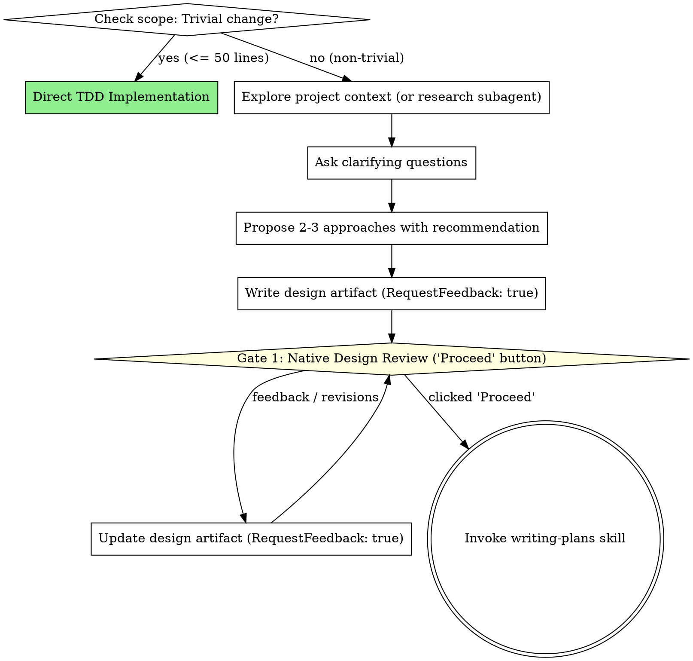

# Brainstorming Ideas Into Designs

## Overview

Help turn ideas into fully formed designs and specifications through collaborative dialogue.

Start by understanding project context, asking clarifying questions, exploring alternative approaches, and presenting a concrete design in structured sections.

<HARD-GATE>
Do NOT invoke implementation skills, write production code, scaffold files, or take implementation action until you have written the design artifact with `RequestFeedback: true` and obtained user approval via the native "Proceed" review button (Gate 1).
</HARD-GATE>

## Trivial Changes Exemption

- If the task is a scoped edit (under ~50 lines across 1–2 files: simple bugfix, typo, config tweak, or localized utility function), **skip brainstorming and formal plans**.
- Before implementing, **always provide or respect the user's choice between running via an `implementer` subagent (clean context) vs. running directly inline in current chat**. Never assume inline unilaterally.
- Once implementation finishes, **always launch the `code-reviewer` subagent** to independently verify changes before completing work.

## Checklist

1. **Explore project context** — check files, docs, git log. If extensive codebase research is needed, consider dispatching a `research` subagent to avoid polluting the main context.
2. **Ask clarifying questions** — use `ask_question` for structured decisions and trade-offs, or chat prose for open dialogue.
3. **Propose 2-3 approaches** — with trade-offs and your clear recommendation.
4. **Write the design artifact (`RequestFeedback: true`)** — write `<appDataDir>\brain\<conversation-id>\YYYY-MM-DD-<topic>-design.md` directly inline with `ArtifactMetadata` (`RequestFeedback: true`).
5. **Gate 1: Native Design Review ("Proceed" button)** — stop calling tools and end your turn (do NOT call `ask_question`) so Antigravity renders the native Artifact Review UI with the **"Proceed"** button and inline commenting.
6. **Revise or transition** — if the user submits comments/revisions, update the artifact (`RequestFeedback: true`) and wait; once approved via **"Proceed"**, transition to `writing-plans`.

## Process Flow



## The Process

### 1. Understanding the Idea & Context
- Check current codebase state: recent commits, active files, readme.
- If broad multi-file or dependency exploration is needed, dispatch a background `research` subagent:
  ```json
  {
    "Subagents": [
      {
        "TypeName": "research",
        "Role": "Codebase Researcher",
        "Prompt": "Investigate existing implementations and architecture for [FEATURE]. Return file references, interfaces, and patterns."
      }
    ]
  }
  ```
- Focus on understanding: purpose, persona, technical constraints, edge cases.

### 2. Exploring Approaches
- Propose 2-3 alternative approaches with trade-offs.
- Highlight your recommended approach first with explicit rationale.
- Use `ask_question` for user choices to make feedback frictionless.

### 3. Write the Design Artifact (`RequestFeedback: true`) & Gate 1 (Native Design Review)
- Write the complete design document directly inline to the session artifact directory `<appDataDir>\brain\<conversation-id>\YYYY-MM-DD-<topic>-design.md` using `write_file` with:
  ```json
  "ArtifactMetadata": {
    "Summary": "Design specification for <topic>",
    "UserFacing": true,
    "RequestFeedback": true
  }
  ```
- Do NOT dispatch an external subagent to write the design doc: writing inline preserves the full context, nuance, and user decisions made throughout the dialogue.
- Include structured sections scaled to complexity:
  - Architecture & components
  - Data flow & storage
  - Error handling & edge cases
  - Testing & verification strategy
- **Gate 1 (Native "Proceed" Button):** Immediately after creating the design artifact with `RequestFeedback: true`, **stop calling tools and end your turn** (do NOT call `ask_question`). Point the user to the artifact so Antigravity renders the native Artifact Review UI with the **"Proceed"** button and inline commenting.
- If the user submits comments/revisions, update the design artifact via `edit_file` (with `ArtifactMetadata` and `RequestFeedback: true`) and end turn again.
- Once the user clicks **"Proceed"** ("The user has approved this document"), transition immediately to the `writing-plans` skill.

### 4. Transition to Planning
- Hand off immediately to the `writing-plans` skill to generate bite-sized tasks, initialize the native `<appDataDir>\brain\<conversation-id>\task.md` task tracker, and configure the `Execution Profile`.
