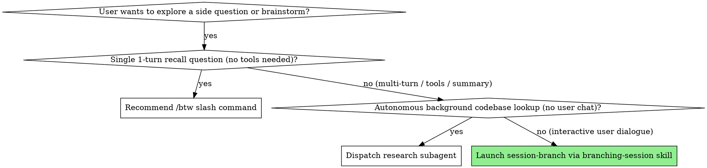

# Branching Session (`branching-session`)

## Overview

Create an isolated, context-aware side-session subagent (`session-branch`) that inherits the current session's context so the user can freely discuss tangential questions, test architectural ideas, or clarify planning details **without polluting the main conversation's context window**.

When the user finishes the side discussion, the subagent either:
- **Merges a compact summary (`BRANCH_RESULT: SUMMARY`)** back into the main session and is immediately terminated (`kill`), OR
- **Dies silently (`BRANCH_RESULT: DISCARD`)** without transferring any discussion data into the main session.

## When to Use



**Trigger symptoms & requests:**
- "Давай создадим ветку / саб-агента, чтобы обсудить..."
- "Ответви сессию, хочу кое-что выяснить и не мусорить в основном чате"
- "Open a side session / planning branch to discuss X"
- During `brainstorming` or `writing-plans`, when the user wants to deep-dive into a tricky architectural question before deciding whether to include it in the plan.

## Workflow

### Step 1: Launch the `session-branch` Subagent

Call `invoke_subagent` with `TypeName: "session-branch"`, `Model: "inherit"`, and `Workspace: "inherit"`:

```json
{
  "TypeName": "session-branch",
  "Role": "Session Branch: [Short Topic]",
  "Model": "inherit",
  "Workspace": "inherit",
  "Prompt": "You are an interactive Session Branch spawned from the main session.\n\n### Metadata\n- ParentConversationId: <CURRENT_CONVERSATION_ID>\n- TranscriptPath: <APP_DATA_DIR>/brain/<CURRENT_CONVERSATION_ID>/.system_generated/logs/transcript.jsonl\n- ArtifactsDir: <APP_DATA_DIR>/brain/<CURRENT_CONVERSATION_ID>\n- ContextLoaderScript: ~/.gemini/config/plugins/superpowers/skills/branching-session/scripts/load_parent_context.py\n\n### Parent Context Snapshot\n- Current Task / Goal: [1-2 sentences]\n- Key Decisions So Far: [bullet list]\n- Active Files & Plans: [paths]\n\n### Initial Discussion Topic\n[User's initial question or topic for the branch, or 'Greet the user briefly, confirm you have the session context, and open the interactive dialogue prompt.']"
}
```

> **Fallback (Before IDE Restart):** If `invoke_subagent(TypeName: "session-branch")` fails because `agents/session-branch.md` was created in the current session prior to an Antigravity restart, immediately call `define_subagent` (`Name: "session-branch"`, `EnableMCPTools: true`, `EnableWriteTools: false`, `EnableSubagentTools: false`, passing the body of `agents/session-branch.md` as `SystemPrompt`) and then call `invoke_subagent(TypeName: "session-branch", ...)`.

### Step 2: Present the Branch Link & Pause Main Session

Immediately after launching the subagent, output a short message in the main chat and **end your turn** (call no more tools):

```markdown
🌿 **Боковая ветка обсуждения создана:** [Открыть ветку обсуждения](conversation://<subagent-conversation-id>)

Перейдите по ссылке (или откройте карточку саб-агента):
- Общайтесь на любые темы — основной чат остаётся чистым.
- Чтобы завершить и **вернуть выжимку**, выберите в ветке *«Завершить ветку и вернуть саммари»* (или напишите `верни саммари`).
- Чтобы **убить ветку без следа**, выберите *«Убить ветку без передачи данных (Discard)»* (или напишите `умри` / `discard`).
```

### Step 3: Handle Branch Return & Kill Subagent

When the subagent wakes the main session via `send_message`:

| Incoming Message | Main Orchestrator Action |
| :--- | :--- |
| **`BRANCH_RESULT: SUMMARY`** | 1. Immediately run `manage_subagents(Action: "kill", ConversationIds: ["<subagent-id>"])`.<br>2. Display the concise summary in the main chat and apply its decisions to the current plan/task. |
| **`BRANCH_RESULT: DISCARD`** | 1. Immediately run `manage_subagents(Action: "kill", ConversationIds: ["<subagent-id>"])`.<br>2. Output a single line: *"🗑️ Боковая ветка закрыта без передачи данных. Продолжаем основную сессию."* |
| **System idle hook notice** (`Subagent <id> has gone idle...` without `BRANCH_RESULT:`) | The user skipped the modal and is typing in the subagent chat box directly. Do **NOT** kill the subagent yet unless the user asks in the main chat to close it; wait for `BRANCH_RESULT:`. |

## Quick Reference

| Operation | Mechanism | Token Impact on Main Session |
| :--- | :--- | :--- |
| Start branch | `invoke_subagent(TypeName: "session-branch", Model: "inherit")` | 1 tool call (~300–800 tokens) |
| Multi-turn dialogue in branch | Handled inside `conversation://<id>` via `ask_question` loop | **0 tokens** in main session |
| On-demand deep history sync | `python load_parent_context.py --transcript ...` inside branch | **0 tokens** in main session |
| Close with `DISCARD` | `send_message("BRANCH_RESULT: DISCARD")` -> `manage_subagents(Action: "kill")` | Negligible (~50 tokens) |
| Close with `SUMMARY` | `send_message("BRANCH_RESULT: SUMMARY...")` -> `manage_subagents(Action: "kill")` | Only the clean summary (~150–300 tokens) |

## Common Mistakes

- **Polling the subagent:** Never call `manage_subagents(Action: "list")` in a loop or set timers. Stop your turn after launching; `send_message` wakes the main session automatically.
- **Forgetting to kill the subagent on return:** Always call `manage_subagents(Action: "kill")` as soon as `BRANCH_RESULT: SUMMARY` or `BRANCH_RESULT: DISCARD` arrives so the subagent shows as `killed` (closed) in the UI panel.
- **Dumping raw `transcript.jsonl` into the initial prompt:** Pass a compact 5–15 bullet `Parent Context Snapshot` in `Prompt` and let the subagent run `load_parent_context.py` only if deeper history is needed.
