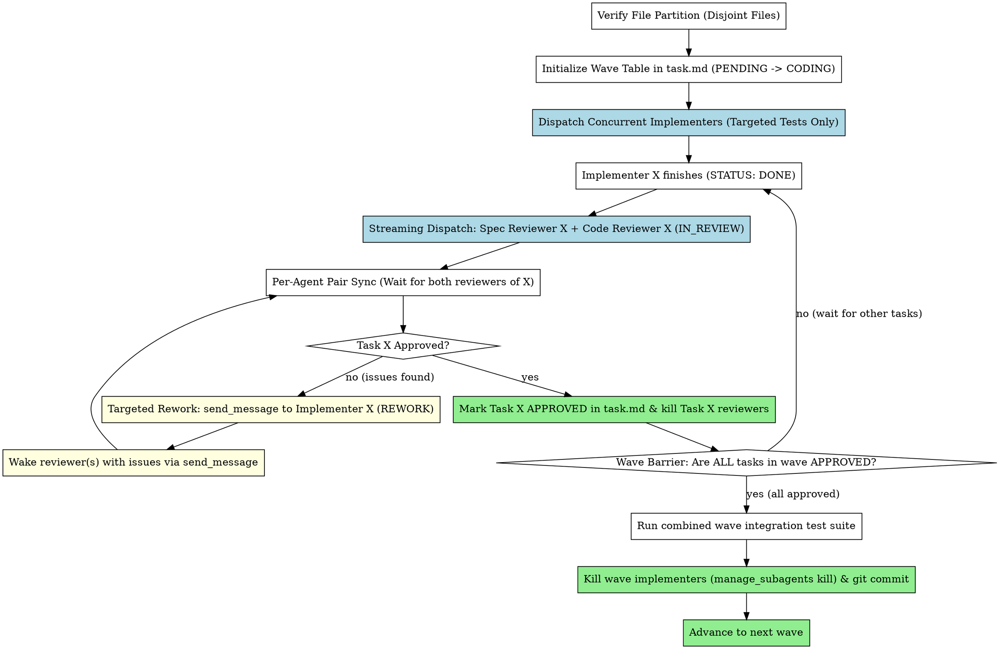

# Dispatching Parallel Subagents

Execute independent tasks within a plan wave concurrently by dispatching multiple `implementer` subagents in a single `invoke_subagent` call, streaming dedicated `spec-reviewer` + `code-reviewer` validation pairs immediately as each coder finishes, routing targeted rework to the exact author subagents via `send_message`, tracking live progress in the native session artifact `<appDataDir>\brain\<conversation-id>\task.md`, and enforcing a strict wave barrier before integration testing and committing.

**Core principle:** Strict file partitioning + concurrent subagent execution + per-agent streaming parallel review (`spec-reviewer` + `code-reviewer`) + live `task.md` tracking + targeted author rework (`send_message`) + strict wave synchronization barrier.

**Announce at start:** "I'm using the dispatching-parallel-agents skill to execute independent tasks in this wave in parallel."

## When to Use

Use parallel execution when:
- Tasks in the current wave have no sequential dependencies on each other.
- Tasks touch completely separate (disjoint) files or modules (e.g., implementing 3 independent services, creating separate test suites, or scaffolding distinct components).
- Or during research/debugging: inspecting multiple independent subsystems simultaneously via multiple read-only `research` subagents.

Do NOT use parallel execution when:
- Task B depends on the output, types, or interface of Task A (put Task A in Wave 1 and Task B in Wave 2).
- Multiple tasks modify the exact same lines of a shared file (extract shared glue registration into a subsequent sequential step/wave).

## Workspace Selection: `inherit` vs `branch`

1. **`Workspace: 'inherit'` (Recommended Default for Disjoint Files):**
   - Use whenever parallel tasks modify **strictly non-overlapping files**.
   - **Why:** Subagents immediately have access to `node_modules`, `.venv`, and compiled build caches. Changes appear directly in the workspace, and targeted rework via `send_message` edits live files directly without repeated branch merges.
   - **Safety Rule:** Parallel subagents in `inherit` mode must ONLY touch their assigned files, run targeted unit tests, and **MUST NOT run `git add` or `git commit`** (preventing `.git/index.lock` contention). The orchestrator commits the wave after all wave tasks are approved and the integration test suite passes.
2. **`Workspace: 'branch'` (For Overlapping Files or Isolated Experiments):**
   - Use only when concurrent tasks cannot avoid touching shared files or require isolated git worktrees.

## The Parallel Wave Lifecycle



## Step-by-Step Procedure

### 1. Partition Verification & `task.md` Wave Table Initialization
Before dispatching, confirm each task has an exclusive, strictly non-overlapping file scope. Initialize or update the native session tracking artifact at `<appDataDir>\brain\<conversation-id>\task.md`. Every `write_file` / `edit_file` on `<appDataDir>\brain\<conversation-id>\task.md` MUST include `ArtifactMetadata: { Summary: "...", UserFacing: true, RequestFeedback: false }` so it renders in the native **Artifacts** tab, and include the progress checklist (`- [ ]` -> `- [x]`) alongside the wave table:

```markdown
# Task Tracking & Wave Status

## Progress Checklist
- [ ] Task 2A: Auth service
- [ ] Task 2B: Billing service

### Wave 2 Execution Status

| Task | Exclusive Files | Implementer ID | Spec Reviewer ID | Code Reviewer ID | Status |
| :--- | :--- | :--- | :--- | :--- | :--- |
| Task 2A (Auth) | `src/auth/*`, `tests/test_auth.py` | - | - | - | PENDING |
| Task 2B (Billing) | `src/billing/*`, `tests/test_billing.py` | - | - | - | PENDING |
```

**Status Lifecycle:** `PENDING` -> `CODING` -> `IN_REVIEW` -> `REWORK` -> `APPROVED ✅`.

### 2. Concurrent Implementation Dispatch (Targeted Tests Only)
Invoke all `implementer` subagents for the wave in a **single `invoke_subagent` call**.

> [!IMPORTANT]
> **Targeted Tests Only:** The prompt to each parallel implementer must instruct them to run **only targeted module tests** (`[TARGETED_TEST_COMMAND_A]`), NOT the entire project test suite. Sibling tasks are being coded concurrently in the same workspace; running full suite tests during implementation could fail due to incomplete sibling files. Implementers must also be explicitly forbidden from running `git add` or `git commit`.

```json
{
  "Subagents": [
    {
      "TypeName": "implementer",
      "Role": "Implementer Task 2A (Auth)",
      "Model": "flash",
      "Workspace": "inherit",
      "Prompt": "Execute Task 2A: Implement Auth module according to spec: [SPEC_2A].\nEXCLUSIVE FILE SCOPE: src/auth/*, tests/test_auth.py. Do NOT touch any other files. Do NOT run git add or git commit.\nFollow TDD. Run ONLY targeted module tests: [TARGETED_TEST_COMMAND_2A]. Return structured report."
    },
    {
      "TypeName": "implementer",
      "Role": "Implementer Task 2B (Billing)",
      "Model": "flash",
      "Workspace": "inherit",
      "Prompt": "Execute Task 2B: Implement Billing module according to spec: [SPEC_2B].\nEXCLUSIVE FILE SCOPE: src/billing/*, tests/test_billing.py. Do NOT touch any other files. Do NOT run git add or git commit.\nFollow TDD. Run ONLY targeted module tests: [TARGETED_TEST_COMMAND_2B]. Return structured report."
    }
  ]
}
```

Immediately update the wave table with returned `conversationId`s and set statuses to `CODING` (pass `ArtifactMetadata: { Summary: "...", UserFacing: true, RequestFeedback: false }` on `edit_file`):

```markdown
# Task Tracking & Wave Status

## Progress Checklist
- [ ] Task 2A: Auth service
- [ ] Task 2B: Billing service

### Wave 2 Execution Status

| Task | Exclusive Files | Implementer ID | Spec Reviewer ID | Code Reviewer ID | Status |
| :--- | :--- | :--- | :--- | :--- | :--- |
| Task 2A (Auth) | `src/auth/*`, `tests/test_auth.py` | `conv-impl-2a` | - | - | CODING |
| Task 2B (Billing) | `src/billing/*`, `tests/test_billing.py` | `conv-impl-2b` | - | - | CODING |
```

### 3. Per-Agent Streaming Parallel Review (Immediate Pair per Completed Coder)
Do **NOT** wait for slower coders in the wave to finish before initiating reviews! As soon as any coder `X` returns `STATUS: DONE` (or if multiple coders `A, B` finish in the same wakeup):
1. Update `task.md` status for that task to `IN_REVIEW` (pass `ArtifactMetadata: { Summary: "...", UserFacing: true, RequestFeedback: false }` on `edit_file`).
2. Immediately launch a dedicated `spec-reviewer` + `code-reviewer` pair **per completed coder** in a single `invoke_subagent` call (if `K` coders finish simultaneously, launch `2 * K` reviewers concurrently).
3. Reviewer prompts must specify the task's exclusive file scope, specific spec, and targeted test command.

```json
{
  "Subagents": [
    {
      "TypeName": "spec-reviewer",
      "Role": "Spec Reviewer Task 2A",
      "Model": "flash",
      "Workspace": "inherit",
      "Prompt": "Verify spec compliance for Task 2A (Auth).\nSpec: [SPEC_2A].\nExclusive Files: src/auth/*, tests/test_auth.py.\nRun only targeted verification: [TARGETED_TEST_COMMAND_2A]. Report SPEC_COMPLIANT or missing requirements."
    },
    {
      "TypeName": "code-reviewer",
      "Role": "Code Reviewer Task 2A",
      "Model": "inherit",
      "Workspace": "inherit",
      "Prompt": "Review code quality, architecture, edge cases, and tests for Task 2A (Auth).\nExclusive Files: src/auth/*, tests/test_auth.py.\nRun only targeted verification: [TARGETED_TEST_COMMAND_2A]. Report Ready to merge: Yes/No with categorized issues."
    }
  ]
}
```

Record the reviewer IDs in `task.md` (pass `ArtifactMetadata: { Summary: "...", UserFacing: true, RequestFeedback: false }` on `edit_file`):

```markdown
# Task Tracking & Wave Status

## Progress Checklist
- [ ] Task 2A: Auth service
- [ ] Task 2B: Billing service

### Wave 2 Execution Status

| Task | Exclusive Files | Implementer ID | Spec Reviewer ID | Code Reviewer ID | Status |
| :--- | :--- | :--- | :--- | :--- | :--- |
| Task 2A (Auth) | `src/auth/*`, `tests/test_auth.py` | `conv-impl-2a` | `conv-spec-2a` | `conv-code-2a` | IN_REVIEW |
| Task 2B (Billing) | `src/billing/*`, `tests/test_billing.py` | `conv-impl-2b` | - | - | CODING |
```

### 4. Per-Agent Pair Sync, Targeted Rework & Re-Review via `send_message`
Review findings and rework are handled strictly per-task:

1. **Per-Agent Pair Sync:** For Task `X`, wait until **both** `Spec Reviewer X` and `Code Reviewer X` have reported before taking action.
2. **Targeted Rework:** If issues are found (spec discrepancies or Critical/Important quality issues):
   - Update `task.md` status to `REWORK` (pass `ArtifactMetadata: { Summary: "...", UserFacing: true, RequestFeedback: false }` on `edit_file`).
   - Consolidate feedback into a single clear instruction.
   - Send fix instructions via `send_message` directly to `Implementer X` (`conversationId_impl_X`).
   - Never modify code inline in the main session.
3. **Smart Re-Review via `send_message`:**
   - Keep reviewer subagents in `idle`.
   - When `Implementer X` completes rework and reports back, re-awaken the **same** reviewer subagent(s) via `send_message`.
   - **Efficiency:** Wake ONLY the reviewer(s) that flagged issues. (For example, if `Spec Reviewer X` had passed `SPEC_COMPLIANT` on the first pass and only `Code Reviewer X` reported issues, send the rework diff only to `Code Reviewer X`.)
4. **Early Reviewer Kill:**
   - Once Task `X` passes both reviews (`Ready to merge: Yes` with 0 unresolved Critical/Important issues):
   - Mark Task `X` as `APPROVED ✅` in `<appDataDir>\brain\<conversation-id>\task.md` and check off its progress item (`- [x] Task X`).
   - Every `write_file` / `edit_file` on `<appDataDir>\brain\<conversation-id>\task.md` MUST include `ArtifactMetadata: { Summary: "...", UserFacing: true, RequestFeedback: false }` so it renders in the native **Artifacts** tab, and include the progress checklist (`- [ ]` -> `- [x]`) alongside the wave table.
   - Immediately kill Task `X` reviewers (`Spec Reviewer X`, `Code Reviewer X`) via `manage_subagents` (`Action: "kill"`).
   - Keep `Implementer X` in `idle` (do not kill yet) until wave integration testing passes.

```markdown
# Task Tracking & Wave Status

## Progress Checklist
- [x] Task 2A: Auth service
- [ ] Task 2B: Billing service

### Wave 2 Execution Status

| Task | Exclusive Files | Implementer ID | Spec Reviewer ID | Code Reviewer ID | Status |
| :--- | :--- | :--- | :--- | :--- | :--- |
| Task 2A (Auth) | `src/auth/*`, `tests/test_auth.py` | `conv-impl-2a` | [terminated] | [terminated] | APPROVED ✅ |
| Task 2B (Billing) | `src/billing/*`, `tests/test_billing.py` | `conv-impl-2b` | `conv-spec-2b` | `conv-code-2b` | IN_REVIEW |
```

### 5. Strict Wave Synchronization Barrier, Integration Test & Commit
Enforce the Wave Barrier:

> [!CAUTION]
> **Wave Synchronization Barrier Rule:** The orchestrator MUST NOT start `Wave N+1` until **every** task in `Wave N` is marked `APPROVED ✅` in `task.md`.

Once ALL tasks in `Wave N` are `APPROVED ✅`:
1. **Wave Integration Test Suite:** Run the combined test suite covering all modules in the wave to ensure clean cross-module integration.
2. **Terminate Implementers:** Terminate all remaining `implementer` subagents from `Wave N` via `manage_subagents`:
   ```json
   {
     "Action": "kill",
     "ConversationIds": ["<conv-impl-2a>", "<conv-impl-2b>"]
   }
   ```
3. **Commit Wave:** Stage and commit all approved wave changes in the primary workspace with a descriptive wave commit message.
4. **Advance:** Advance autonomously to `Wave N+1`.
