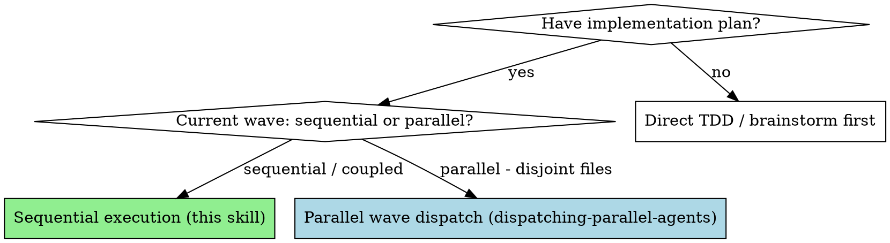
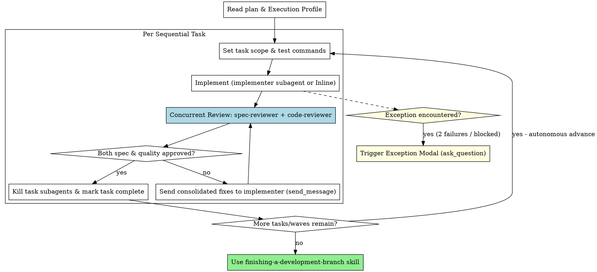

# Sequential Task Execution

Execute sequential tasks (or sequential waves of a plan) by working through one task at a time with concurrent spec + code quality review (`spec-reviewer` and `code-reviewer` launched together) after each task. *(When encountering a `[Parallel — Disjoint Files]` wave in a plan, use `dispatching-parallel-agents` for that wave.)*

**Core principle:** One task at a time + concurrent spec & quality review + original coder rework (`send_message`) + autonomous progression (modal gates only on exceptions or at completion).

## Execution Strategy

Sequential execution is ideal when tasks build upon each other or when strict step-by-step discipline is required.

**Rules:**
1. **One active task at a time** — focus completely on the current task until verified and reviewed (for independent tasks in a parallel wave, use `dispatching-parallel-agents`).
2. **Follow `Execution Profile`** — resolve mode and model for implementation and review from the plan header. If not set, prompt the user via `ask_question` to choose between Subagent (`implementer`) and Inline. Never unilaterally execute inline without user consent.
3. **Use `Workspace: 'inherit'`** — in sequential workflows, all subagents work in the main workspace so changes are directly available for verification and review.
4. **Autonomous Progression** — if a task passes verification and reviews, automatically advance to the next task without interrupting the user.
5. **Concurrent Spec & Quality Review** — launch `spec-reviewer` and `code-reviewer` concurrently in a single `invoke_subagent` call (both are read-only) to halve review latency.
6. **Original coder fixes review issues (`send_message`) & Pair Sync** — wait for both `spec-reviewer` and `code-reviewer` before sending consolidated rework to the `implementer` via `send_message`. If reviews identify issues, rework MUST be performed by the same agent that wrote the code. If an `implementer` wrote the code, the orchestrator is strictly forbidden from fixing files inline. Keep reviewers in `idle` during rework; re-awaken existing reviewer(s) that reported issues via `send_message` after rework instead of spawning new ones. Only fix inline if implementation was configured as `Inline`.
7. **Mandatory Live Task Tracking** — continuously track all tasks, subagent IDs (`Implementer ID`, `Spec Reviewer ID`, `Code Reviewer ID`), and live statuses (`PENDING` -> `CODING` -> `IN_REVIEW` -> `REWORK` -> `APPROVED ✅`) in the native session artifact `<appDataDir>\brain\<conversation-id>\task.md` (created/updated with `ArtifactMetadata: { Summary: "...", UserFacing: true, RequestFeedback: false }` so the tracker displays live in Antigravity's native **Artifacts** tab).

## When to Use



## The Process



## Task Execution Cycle

### 1. Set Task Context
For each task:
- Extract acceptance criteria, target files, and test files from the plan.
- Confirm verification command (e.g. `npm test`, `pytest`, `cargo test`).

### 2. Implement & Verify (Subagent vs Inline)
- **If `Implementation: implementer`:**
  - Dispatch the `implementer` subagent via `invoke_subagent`:
    ```json
    {
      "Subagents": [
        {
          "TypeName": "implementer",
          "Role": "Task Implementer",
          "Model": "<flash | pro | inherit>",
          "Workspace": "inherit",
          "Prompt": "Execute Task N from plan: [FULL TASK DETAILS]. Follow TDD. Run verification: [COMMAND]. Return structured report."
        }
      ]
    }
    ```
  - Subagent executes in the background. Reactive wakeup occurs upon completion.
  - Review structured return (`STATUS: DONE`, files modified, test command evidence). Keep subagent in `idle` state until review passes.
  - **Two-Failure Exception Rule:** If tests fail twice consecutively on the same task, halt and trigger an `ask_question` modal to escalate model or switch to inline mode.
- **If `Implementation: Inline`:**
  - Follow TDD in the primary session, write minimal code, and execute verification commands.

### 3. Mandatory Concurrent Spec & Code Quality Review
- **Live Status Tracking in native `<appDataDir>\brain\<conversation-id>\task.md` artifact:**
  - Track every task, its subagent IDs (`Implementer ID`, `Spec Reviewer ID`, `Code Reviewer ID`), and live status in the native session artifact `<appDataDir>\brain\<conversation-id>\task.md`. All updates via `write_file` / `edit_file` MUST include `ArtifactMetadata: { Summary: "...", UserFacing: true, RequestFeedback: false }` so the tracker displays live in Antigravity's native **Artifacts** tab, updating both the progress checklist (`- [ ]` -> `- [x]`) and the status table (`PENDING` -> `CODING` -> `IN_REVIEW` -> `REWORK` -> `APPROVED ✅`):
    - When coding begins: set status to `CODING` and record `Implementer ID`.
    - When coding finishes and review subagents launch: record `Spec Reviewer ID` and `Code Reviewer ID`, and set status to `IN_REVIEW`.
    - When review issues require fixes: set status to `REWORK`.
    - When all reviews pass: set status to `APPROVED ✅`.
- Immediately after coding completes, **ALWAYS dispatch `spec-reviewer` and `code-reviewer` concurrently in a single `invoke_subagent` call** (both are read-only, cutting review wait time in half):
  ```json
  {
    "Subagents": [
      {
        "TypeName": "spec-reviewer",
        "Role": "Spec Reviewer",
        "Model": "flash",
        "Workspace": "inherit",
        "Prompt": "Compare implementation of Task N against specification. Target files: [FILES]. Task spec: [SPEC]."
      },
      {
        "TypeName": "code-reviewer",
        "Role": "Code Quality Reviewer",
        "Model": "<pro | inherit | flash>",
        "Workspace": "inherit",
        "Prompt": "Audit implementation of Task N for architecture, edge cases, error handling, security, and test quality. Modified files: [FILES]."
      }
    ]
  }
  ```
- **Pair Synchronization & Re-Review via `send_message`:**
  - **Wait for Both Reviewers:** Always wait for both `spec-reviewer` and `code-reviewer` to return before taking action. Do not forward review findings piecemeal.
  - **Handling Review Issues (Strict Coder Delegation):**
    - If spec discrepancies or Critical/Important quality issues are flagged:
      - Update status to `REWORK` in `task.md`.
      - If implementation was done by `implementer`: **Strictly delegate rework to the coder subagent.** Consolidate all findings from `spec-reviewer` and `code-reviewer` and send them to the original `implementer` via `send_message` with its `conversationId`. The orchestrator must NEVER hijack the fix and write code in the primary session.
      - The implementer fixes all issues in a single pass using TDD, executes verification commands, and reports back.
      - If implementation was `Inline`: the orchestrator fixes the issues directly in the current chat and re-verifies.
  - **Re-Review via `send_message`:**
    - Keep both reviewers in `idle` during rework.
    - When the coder reports fixes, update status back to `IN_REVIEW` in `task.md`.
    - Re-awaken the existing reviewer(s) that flagged issues via `send_message` with their `conversationId` instead of spawning new reviewer subagents.
  - Once both reviewers confirm approval (`Ready to merge: Yes` and spec compliant), set status to `APPROVED ✅` in `task.md`.
- When approved, terminate the task's subagents (`implementer`, `spec-reviewer`, `code-reviewer`) via `manage_subagents` (`Action: 'kill'`).

### 4. Autonomous Advance & Completion
- As long as tasks pass verification and reviews, **advance automatically to the next task or wave**.
- When all tasks are completed, reviewed, and verified, invoke `finishing-a-development-branch`.
