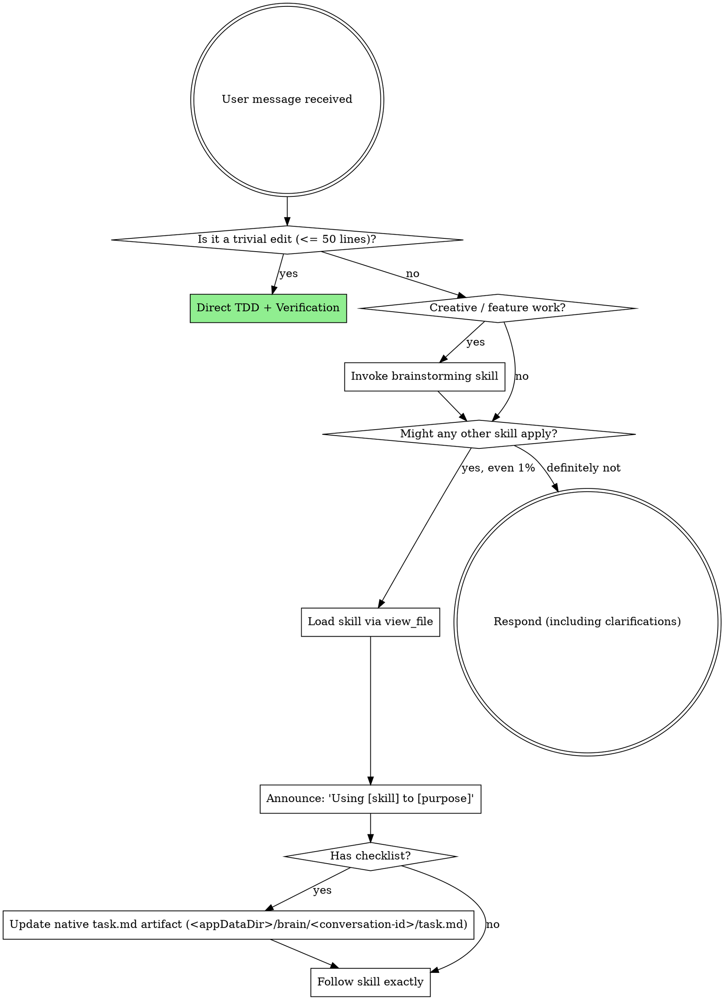

<EXTREMELY-IMPORTANT>
If you think there is even a 1% chance a skill might apply to what you are doing, you ABSOLUTELY MUST invoke the skill.

IF A SKILL APPLIES TO YOUR TASK, YOU DO NOT HAVE A CHOICE. YOU MUST USE IT.

This is not negotiable. This is not optional. You cannot rationalize your way out of this.
</EXTREMELY-IMPORTANT>

## Subagent Mode Notice

If you are running as an invoked subagent (spawned by a parent agent), **DO NOT invoke process skills** (`using-superpowers`, `brainstorming`, `writing-plans`). Your role is focused execution or review as directed by your prompt.

## Trivial Changes Exemption

Before triggering a full brainstorming workflow, check the task scope:
- If the task is a scoped edit (under ~50 lines across 1–2 files: simple bugfix, typo, config tweak, or localized utility function), **skip brainstorming and formal plans**.
- When ready to implement, **always provide or respect the choice between running via an `implementer` subagent (clean context) vs. running directly inline in the current chat**. Never unilaterally force inline coding.
- **Trivial Tweaks (≤ 10 lines):** For trivial edits and tweaks (≤ 10 lines diff across 1 file: e.g., null guard, typo, minor config toggle, localized fix) where verification/build passes cleanly and diff is verified, calling the heavy `code-reviewer` subagent may be bypassed. For larger scoped edits (> 10 lines up to ~50 lines), once implementation finishes and tests pass, **always launch the `code-reviewer` subagent** to independently audit the changes before claiming completion.

## How to Access Skills

**In Antigravity:** Use `view_file` to load a skill from:
1. Project-local skills: `.agents/skills/<skill-name>/SKILL.md` (or `.agent/skills/...`)
2. Plugin skills: `~/.gemini/config/plugins/superpowers/skills/<skill-name>/SKILL.md`
3. Global user skills: `~/.gemini/skills/<skill-name>/SKILL.md`
4. Built-in skills: `~/.gemini/antigravity/builtin/skills/<skill-name>/SKILL.md`

When you load a skill, follow it directly.

# Using Skills

## The Rule

**Invoke relevant or requested skills BEFORE any response or action.** Even a 1% chance a skill might apply means that you should invoke the skill to check. If an invoked skill turns out to be wrong for the situation, you don't need to use it.

## Red Flags

These thoughts mean STOP—you're rationalizing:

| Thought | Reality |
|---------|---------|
| "This is just a simple question" | Questions are tasks. Check for skills. |
| "I need more context first" | Skill check comes BEFORE clarifying questions. |
| "Let me explore the codebase first" | Skills tell you HOW to explore. Check first. |
| "I can check git/files quickly" | Files lack conversation context. Check for skills. |
| "Let me gather information first" | Skills tell you HOW to gather information. |
| "This doesn't need a formal skill" | If a skill exists, use it. |
| "I remember this skill" | Skills evolve. Read current version. |
| "This doesn't count as a task" | Action = task. Check for skills. |
| "The skill is overkill" | Simple things become complex. Use it. |
| "I'll just do this one thing first" | Check BEFORE doing anything. |
| "This feels productive" | Undisciplined action wastes time. Skills prevent this. |
| "I know what that means" | Knowing the concept ≠ using the skill. Invoke it. |

## Skill Priority

When multiple skills could apply, use this order:

1. **Process skills first** (brainstorming, debugging) - these determine HOW to approach the task.
2. **Implementation skills second** (TDD, executing-plans, dispatching-parallel-agents) - these guide execution.

"Let's build X" → brainstorming first, then implementation skills.
"Fix this bug" → debugging first, then domain-specific skills.
